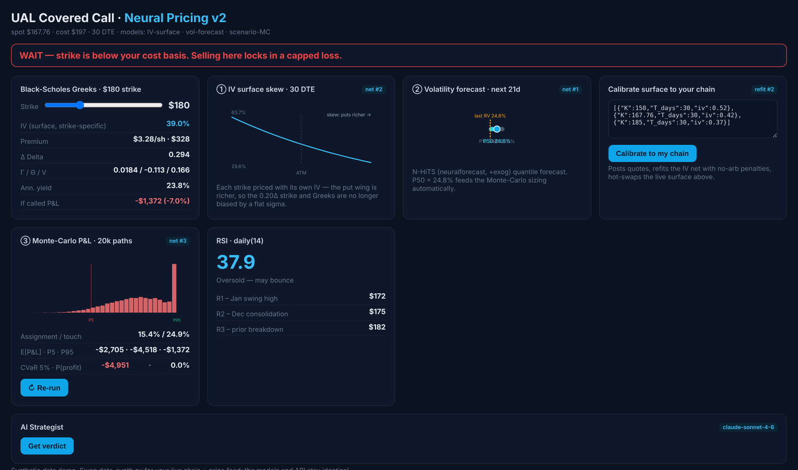
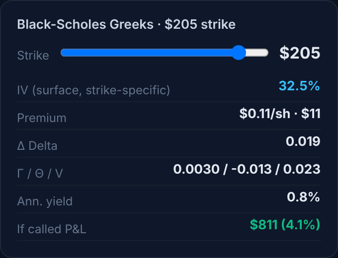
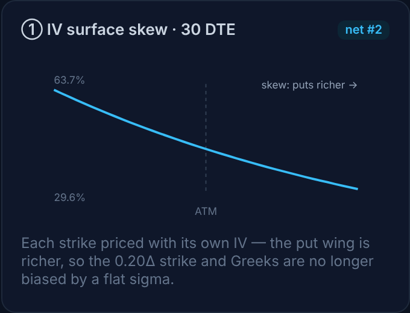
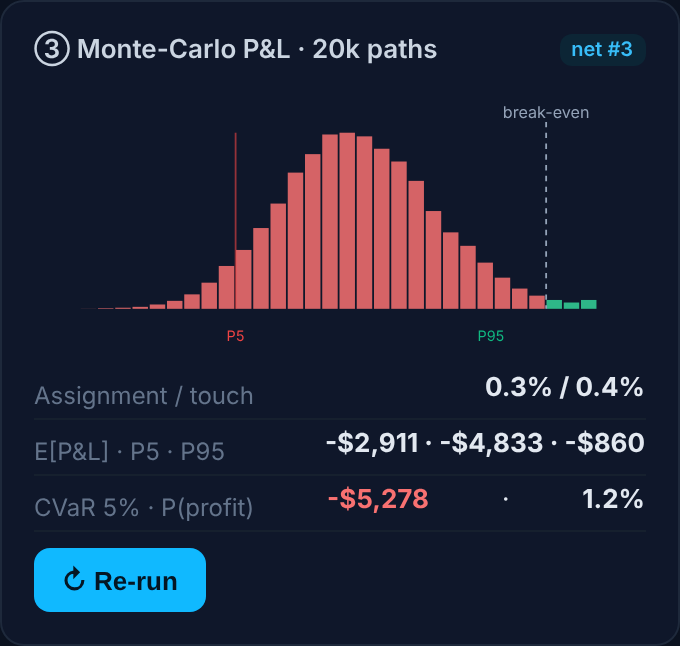
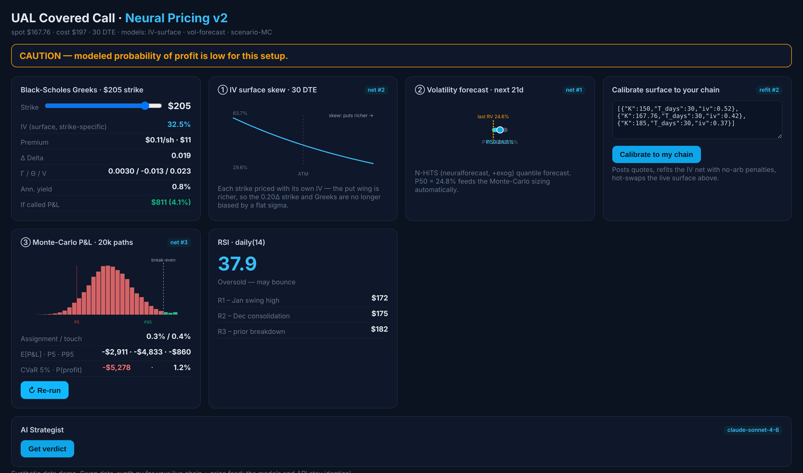

# Neural Covered-Call Pricing — UAL

Deep-learning dashboard that helps decide **whether, when and at which strike** to sell a covered call on United Airlines (UAL). Three neural models — a volatility forecaster, an implied-volatility surface and a scenario generator — feed a React dashboard through a Flask API.

> ⚠️ Educational project. Not financial advice. The demo runs on **synthetic data** so it works offline; swap `data_synth.py` for a live price feed and option chain to use real data.



---

## What you'll find in the dashboard

### 1. Decision banner
A one-line verdict at the top that reacts to the strike you choose:
- 🔴 **WAIT** — the strike is below your cost basis, so being called away locks in a loss.
- 🟢 **FAVORABLE** — strike above cost basis and daily RSI elevated (good moment to sell calls).
- 🟠 **CAUTION** — the strike is safe, but the simulated probability of profit is low.
- 🟣 **NEUTRAL** — mixed conditions.

### 2. Black-Scholes Greeks — with a strike slider


Drag the slider to choose a strike. The panel recalculates:
- **IV for that exact strike** (read from the neural surface, not a single flat volatility)
- **Premium** per share and per contract
- **Delta, Gamma, Theta, Vega**
- **Annualised yield** of the premium
- **P&L if the shares are called away**

<br clear="right"/>

### 3. Implied-volatility surface (neural net #2)


A neural network based on *deep SVI* learns the volatility smile across strikes and maturities, with soft **no-arbitrage** penalties. The chart shows the skew: lower strikes (puts) carry higher IV, so each strike gets its own fair price.

You can paste quotes from your own broker in **"Calibrate surface to your chain"** — the network is refit and the live surface updates.

<br clear="right"/>

### 4. Volatility forecast (neural net #1)
**N-HiTS** (via `neuralforecast`) forecasts realised volatility for the next 21 days using price returns, VIX and volume as extra inputs. It returns a range — **P10 / P50 / P90** — and the P50 automatically drives the Monte Carlo. If `neuralforecast` is not installed, an LSTM forecaster is used instead.

### 5. Monte Carlo P&L — 20,000 paths (neural net #3)


A **variational autoencoder (VAE)** generates realistic, fat-tailed price paths. The histogram shows the full distribution of outcomes for the trade, with the break-even line, plus:
- **Assignment / touch probability** — chance the shares are called away
- **Expected P&L, P5 and P95**
- **CVaR 5%** — average loss in the worst 5% of scenarios
- **Probability of profit**

<br clear="right"/>

### 6. RSI and resistance levels
Daily RSI(14) with a short reading (oversold / neutral / overbought) and the nearest resistance levels — useful to judge whether the stock is likely to reach the strike.

### 7. AI Strategist (optional)
Sends every number on the screen to Claude and returns a short verdict: timing, key risks, an alternative and a bottom line. Needs your own Anthropic API key (see below).

### Same position, different strike
Moving the strike from $180 to $205 changes the verdict: being called away is now profitable, but the premium is tiny and the simulated probability of profit drops — the banner switches to **CAUTION**.



---

## Quick start

**1. Backend (Python 3.12 recommended)**
```bash
cd v2/files
python -m venv .venv
.venv\Scripts\activate            # macOS/Linux: source .venv/bin/activate
pip install -r requirements.txt
python app.py                     # API on http://localhost:5001
```
Trained models are already included. To retrain: `python train_all.py` (~1 min on CPU).

> `neuralforecast` (N-HiTS) does not support Python 3.13 yet. On 3.13 the app still runs, using the LSTM forecaster.

**2. Front-end**
```bash
cd frontend
npm install
```
Copy `v2/files/covered_call_dashboard_v2.jsx` to `frontend/src/` and render it from `main.jsx`, then:
```bash
npm run dev                       # http://localhost:5173
```

## API keys
No keys are included in this repository. The only one used is optional — for the **AI Strategist** panel. Copy `.env.example` to `.env` inside your Vite project and add your own key:
```
VITE_ANTHROPIC_API_KEY=sk-ant-...
```
🔒 `VITE_` variables end up in the browser bundle — run the dashboard **locally only**.

## Repository layout
| Path | Content |
|---|---|
| `v2/files/` | **Current version** — models (`iv_surface.py`, `vol_forecaster*.py`, `scenario_gen.py`), training script, Flask API, trained checkpoints and the dashboard (`covered_call_dashboard_v2.jsx`). Technical details and API endpoints in `v2/files/README.md`. |
| `backend/`, `frontend/` | v1 dashboard (Black-Scholes, GARCH, SABR, parameter sweeps) |
| `app.py` | Stand-alone v1 engine |
| `docs/images/` | Screenshots used in this README |

## Tech
Python · PyTorch · neuralforecast (N-HiTS) · Flask · React · Vite · NumPy · SciPy

**Author:** Rodrigo Chemite Barbosa · [github.com/ch3m1bb5](https://github.com/ch3m1bb5)
